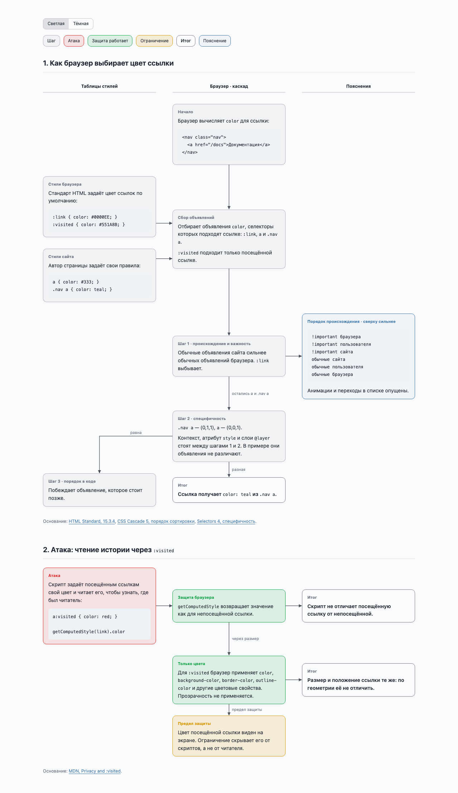
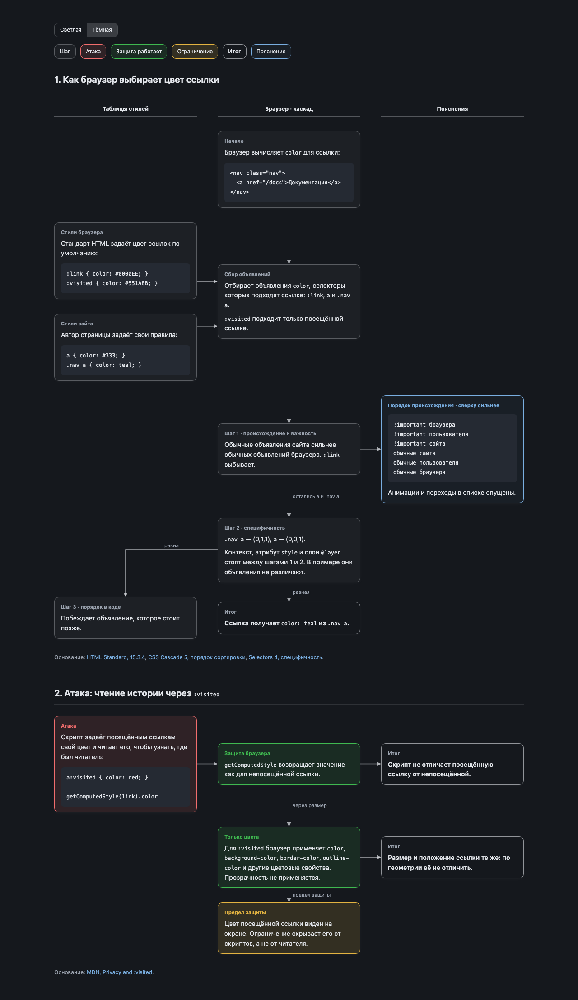

# html-flow-diagram

Скилл Claude Code: объясняет техническую тему одной HTML-схемой. Один файл без внешних ресурсов: дорожки участников, блоки по типам, стрелки с подписями, код и HTTP-примеры внутри блоков, первоисточники под схемой, переключатель «Светлая / Тёмная».

| Светлая тема | Тёмная тема |
| --- | --- |
|  |  |

Пример — [example/css-link-color.html](example/css-link-color.html): как браузер выбирает цвет ссылки по каскаду CSS и как он скрывает историю посещений от скриптов.

## Установка

```sh
git clone git@github.com:makhnatkin/html-flow-diagram.git
cd html-flow-diagram
./install.sh    # ссылка ~/.claude/skills/html-flow-diagram на эту папку
```

Для `flowdiag` нужны Python 3.9+ и Chrome или Chromium; путь к браузеру задаёт переменная `CHROME`. Для `flowdiag sanitize` — npm и Node 22.12+, путь задаёт `NODE`.

## Как работает

Запрос вида «объясни схемой, как …» или «explain with an HTML diagram» вызывает скилл. Модель собирает факты с основаниями, копирует [template.html](template.html), раскладывает блоки по дорожкам, связывает их стрелками, проверяет раскладку через `flowdiag check` и снимки обеих тем через `flowdiag shot`.

## Разметка

```html
<div class="dg center" data-edges="a>b|запрос;b>c">
  <div class="lane" style="grid-column:1;grid-row:1">Клиент</div>
  <div class="bx step" id="a" style="grid-column:1;grid-row:2"><div class="tag">Начало</div>Клиент отправляет запрос.</div>
  <div class="bx chk" id="b" style="grid-column:2;grid-row:2"><div class="tag">Проверка</div>Сервер проверяет токен.</div>
  <div class="bx out" id="c" style="grid-column:2;grid-row:3"><div class="tag">Итог</div>Ответ 200.</div>
</div>
```

Типы блоков: `step` — шаг, `atk` — атака или ошибка, `chk` — проверка работает, `plan` — в плане, `gap` — слабое место, `out` — итог, `note` — пояснение. Правила раскладки и текста — в [SKILL.md](SKILL.md).

## Команды

| Команда | Что делает |
| --- | --- |
| `flowdiag check схема.html` | перекрытия блоков, стрелки через чужие блоки, подписи на блоках, отсутствующие и повторные `id`, переключатель темы |
| `flowdiag shot схема.html` | `схема.light.png` и `схема.dark.png` во всю высоту страницы |
| `flowdiag nojs схема.html` | `схема.nojs.html` для HTML-блока без скриптов: координаты в px, стрелки из `div` и `span`, переключатель темы на CSS |
| `flowdiag sanitize схема.nojs.html` | прогон через санитайзер по умолчанию из `@diplodoc/html-extension` 2.9.7 и сравнение до и после |

## Файлы

- [SKILL.md](SKILL.md) — инструкция скилла.
- [template.html](template.html) — каркас схемы: палитры, стили, легенда, раздел с тремя дорожками, скрипт стрелок.
- [flowdiag](flowdiag) и [flowdiag.js](flowdiag.js) — команды и код, который они выполняют в headless Chrome.
- [example/](example) — готовая схема.
